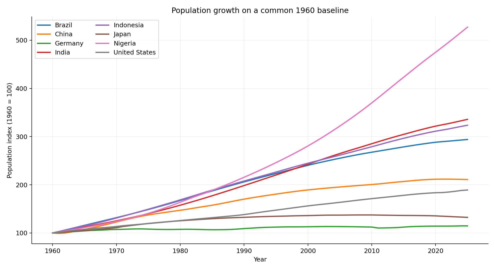
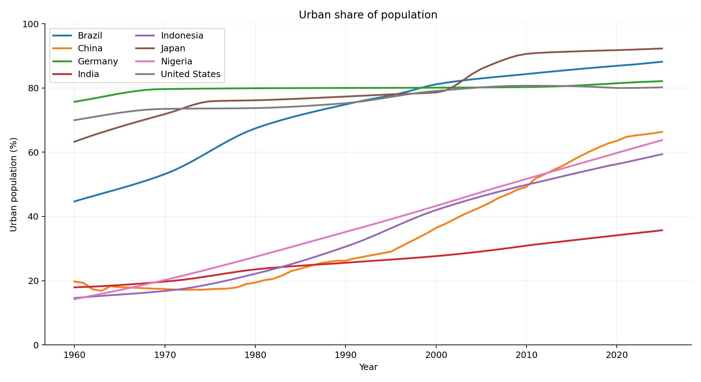
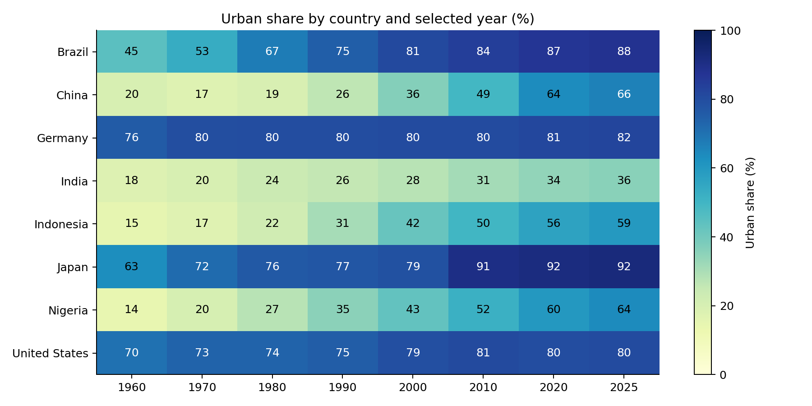

# Population and urbanisation analysis

A Pandas and Matplotlib exploration of how population size and urban share have changed across eight countries. The question is whether an apparent demographic opportunity comes from population growth, urbanisation, or both.

The frozen World Bank snapshot covers **528 country-year rows, 1960-2025**, for India, China, Indonesia, Brazil, Nigeria, the United States, Japan and Germany. Both selected indicators are complete in this snapshot. The analysis does not fill missing observations if a future refresh introduces gaps.

## Visuals







Indexed population helps compare growth without letting a large country dominate the scale. The heatmap shows urban share, rather than comparing raw urban populations on the same colour scale.

## Run

```sh
pip install -r requirements.txt
python analysis.py
python -m unittest discover -s tests -v
```

The snapshot is included, so analysis does not need network access. To refresh it deliberately, run `python download_data.py` first. A refresh may change historical estimates; the original retrieval date and checksums are in `data/provenance.json`.

Open `outputs/report.html` for the charts and the latest-country summary, or use `exploration.ipynb` for a short notebook walkthrough.

## Method and limits

- Parse the two indicator responses into long-format DataFrames.
- Validate country-year uniqueness and indicator ranges, then join one-to-one.
- Calculate annual growth only across adjacent years. A two-year gap is not reported as annual growth.
- Use an actual 1960 observation as the index baseline. Preserve missing values.
- Estimate urban population from total population multiplied by urban share. This is a derived estimate, not a third independent indicator.
- Compare the latest common year and export the cleaned data and country summary.

National definitions of urban areas vary, and source estimates can be revised. These indicators help frame a market-sizing question, but do not establish customer demand, purchasing power or a causal effect of urbanisation. No forecasting model is used.

Code: MIT. Data: World Bank World Development Indicators, CC BY 4.0; see `DATA_SOURCE.md` for attribution and indicator sources.
